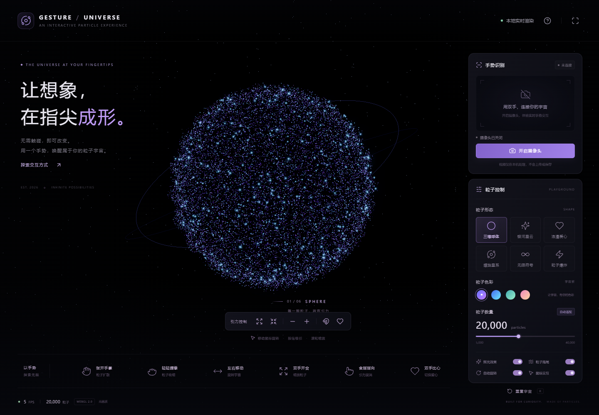
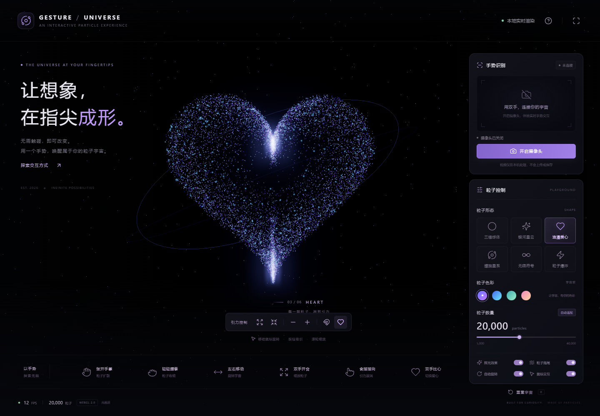
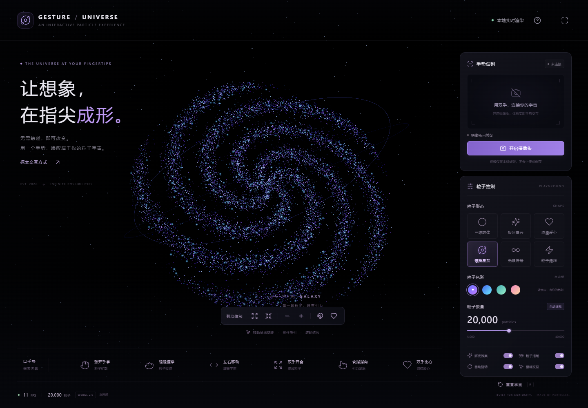
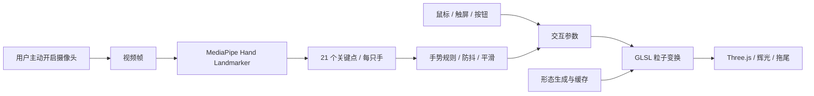

# Gesture Particle Universe · 手势粒子宇宙

**用一双手，让粒子在空间中成形。**

Gesture Particle Universe 是一个浏览器中的实时视觉交互项目。它将摄像头捕捉到的手部动作映射为三维粒子的扩散、收缩、旋转、缩放和局部吸引，让使用者通过身体动作探索数字空间。

[在线体验](https://lizijiaohu.s13753540656.workers.dev/) · [使用教程](docs/USER_GUIDE.md) · [技术说明](docs/TECHNICAL.md) · [演示流程](docs/DEMO.md) · [发展计划](docs/ROADMAP.md)

> 当前版本：可运行的浏览器交互原型。在线地址由 Cloudflare Workers 托管；GitHub 仓库用于源码管理，目前未配置 GitHub Pages。



*截图来自开发阶段的软件渲染环境，截图中的 FPS 不代表真实显卡的性能基准。*

## 为什么做这个项目

传统三维创作与可视化工具通常依赖菜单、鼠标和复杂参数。这个项目尝试用直观的身体动作降低首次体验门槛：张开手掌就扩散，握拳就收拢，双手拉开就放大。

当前可以用于互动展览原型、课堂中的图形与计算机视觉演示，以及自然交互方式的探索。它们是可探索的应用场景，尚未进行教育效果或实际用户研究。

## 先体验，再了解实现

1. 打开在线体验，先移动鼠标或触屏滑动，观察球体旋转。
2. 点击「开启摄像头」，允许访问，等待状态变为「运行中」。
3. 面向摄像头展开手掌，再握拳，观察粒子的变化。
4. 用右侧面板切换形态和配色。手机端点击右上角滑杆图标展开面板。
5. 结束时点击「关闭摄像头」。

摄像头需要 **HTTPS 或 localhost**。无摄像头时，鼠标、触屏与屏幕按钮仍可使用。完整手势说明见[使用教程](docs/USER_GUIDE.md)。

## 已实现的能力

| 能力 | 当前实现 |
| --- | --- |
| 三维形态 | 球体、银河星云、爱心、螺旋星系、无限符号、粒子爆炸 |
| 平滑变化 | GSAP 驱动约 1.75 秒形态插值，可在过渡中再次切换 |
| 手势交互 | 单手扩散、收缩、旋转、指尖漩涡；双手缩放、比心切换爱心 |
| 替代操作 | 鼠标、触屏、按钮、快捷键和重置 |
| 视觉效果 | 蓝紫青色渐变、四组配色、辉光、拖尾、流动与旋转 |
| 性能调节 | 桌面初始 20,000 粒子；小屏或低核心设备初始 12,000；可手动设置 5,000–40,000 |
| 摄像头管理 | 权限错误提示、取消初始化、停止视频流、关闭识别器及 Worker |
| 本地处理 | 模型和 WASM 随项目提供；应用不上传或保存摄像头画面 |

<table>
<tr><td></td><td></td></tr>
<tr><td align="center">爱心</td><td align="center">螺旋星系</td></tr>
</table>

## 工程重点

- **把感知与画面更新解耦**：MediaPipe 优先在经典 Worker 中推理，每次只处理一帧；Three.js 使用独立渲染循环，减少推理任务堆积。
- **让动作连续而稳定**：检测阈值、几何手势规则、动作防抖、比心冷却、丢手宽限与平滑插值协同工作。
- **把每帧粒子形变交给 GPU**：使用 BufferGeometry 和 ShaderMaterial。CPU 生成并缓存分布，Shader 负责插值、流动、缩放和局部漩涡。
- **为现场体验保留替代路径**：识别不稳定时可改用按钮；GPU 推理不可用时尝试 CPU；Worker 不兼容时尝试主线程限频推理；低帧率时自动降低画面负载。

项目采用预训练的 MediaPipe Hand Landmarker，没有训练新的手部模型。主要自定义工作是交互映射、稳定机制、粒子分布、Shader、兼容回退、资源生命周期与界面整合。比心使用几何启发式规则，不能视为通用手语识别。

## 技术架构



| 层次 | 技术 |
| --- | --- |
| 界面与工程 | React、Vite、TypeScript、CSS3、Lucide |
| 图形 | Three.js、GLSL、GSAP |
| 视觉感知 | MediaPipe Hand Landmarker、WebAssembly、Web Worker |
| 部署 | 静态站点，可发布到支持 HTTPS 的静态托管服务 |

## 本地运行

安装包含 npm 的 **Node.js 22.12+**，然后执行：

```bash
git clone https://github.com/s13753540656-sys/gesture-particle-universe.git
cd gesture-particle-universe
npm install
npm run dev
```

打开终端显示的本地地址，通常为 `http://localhost:5173`。安装、启动和构建前会准备本地 WASM 与经典 Worker；官方模型已放在 `public/mediapipe/hand_landmarker.task`。

```bash
npm run build    # TypeScript 检查并生成 dist/
npm run preview  # 预览生产构建
npm test         # 运行手势和形态行为测试
```

部署时上传完整 `dist/` 目录，包含模型、Worker 和 WASM。若部署到仓库子路径，需要同步配置 Vite base 并核对资源地址；当前配置用于域名根路径。详细工程说明见[技术文档](docs/TECHNICAL.md)。

## 隐私、运行条件与验证范围

- 摄像头仅在用户主动开启后使用，不请求麦克风。应用不包含上传、录制或保存视频的逻辑。
- 托管服务仍会接收普通网页与资源请求；本地处理视频不意味着整个网站完全没有网络通信。
- 现代 Chrome、Edge、Safari 是适配目标。已完成的桌面浏览器检查以 Edge 为主；Safari / iOS 与真人手势效果仍需实机验收。
- 开发阶段已通过 13 项行为测试，并检查过模拟摄像头推理、权限拒绝、模型加载失败、关闭与取消连接、页面离开时的资源释放，以及多个屏幕尺寸。
- 上述检查没有得出跨设备 FPS、端到端延迟或真人识别准确率结论。当前没有统一硬件基准和用户研究数据。

## 当前边界与发展方向

当前所有感知与渲染都在浏览器中运行，尚未接入 RDK、机器人、舵机或其他实体设备。硬件感知接入、设备状态协议、真机联调和真实设备性能测量均列为后续工作，详见[发展计划](docs/ROADMAP.md)。

## 文档与源码导航

- [使用教程](docs/USER_GUIDE.md)：摄像头、手势、手机操作与故障排查。
- [技术说明](docs/TECHNICAL.md)：模块、阈值、性能策略与资源管理。
- [演示流程](docs/DEMO.md)：三分钟演示脚本、录屏建议与现场检查。
- [发展计划](docs/ROADMAP.md)：已实现能力、待验证项和硬件扩展方向。
- `src/graphics/`：Three.js 引擎、GLSL 和形态生成。
- `src/vision/`：识别器、Worker、手势分类与稳定机制。
- `src/hooks/`：摄像头生命周期。
- `src/components/`：场景容器、预览、控制面板与指南。

## 开发方式与第三方来源

开发过程中使用了 Codex 辅助生成和修改代码、编写文档及执行开发检查。功能依据以源码和实际验证记录为准；硬件验证、用户研究与使用者的实机反馈需要继续补充。

手部模型来自 [Google MediaPipe 官方模型](https://storage.googleapis.com/mediapipe-models/hand_landmarker/hand_landmarker/float16/1/hand_landmarker.task)。开发参考包括 [MediaPipe Web 指南](https://developers.google.com/edge/mediapipe/solutions/vision/hand_landmarker/web_js)、[Three.js 文档](https://threejs.org/docs/)与 [GSAP 文档](https://gsap.com/docs/v3/)。第三方库与模型遵循各自原始许可。

本仓库目前未设置项目代码的开源许可证；公开可查看不等于已授予任意复制、修改或分发许可。许可证由项目作者后续确定。
