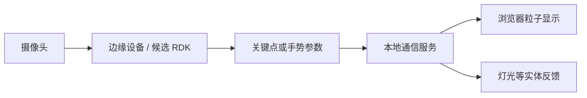

# 发展计划与能力边界

[返回项目首页](../README.md)

本页区分已实现能力、待验证项和计划。计划不代表功能已经可用。

## 已实现

- [x] 六种三维粒子分布与平滑切换。
- [x] 摄像头单手 / 双手关键点识别与六类交互映射。
- [x] 置信度设置、动作防抖、平滑与丢手回中。
- [x] 鼠标、触屏、按钮、全屏和重置。
- [x] Worker / GPU 优先路径及兼容回退。
- [x] 自动粒子数量适配与资源清理。
- [x] 使用教程、技术文档、实际界面截图和演示流程。

## 优先验证

- [ ] 在实际电脑摄像头上记录开掌、握拳、指向、缩放与比心的成功 / 误触发情况。
- [ ] 在不同光线、手部朝向与遮挡程度下重复操作，记录失败条件。
- [ ] 在至少一台 iPhone 和一台 Android 真机上验证权限、前台恢复和资源释放。
- [ ] 使用统一设备记录预热后 FPS、粒子数量、推理模式和测试时长。
- [ ] 测量从动作到画面变化的端到端延迟；不要用推理调用间隔代替延迟。
- [ ] 邀请初次使用者按教程体验，记录无需指导能否完成任务。

建议性能记录表：

| 日期 | 设备 / GPU | 浏览器版本 | 粒子数量 | 辉光 / 拖尾 | 推理模式 | 时长 | FPS / 延迟测量方法 | 结果 |
| --- | --- | --- | --- | --- | --- | --- | --- | --- |
| 待实测 | 待填写 | 待填写 | 待填写 | 待填写 | 待填写 | 待填写 | 待填写 | 未测量 |

开发阶段软件渲染截图和模拟摄像头结果，不作为真实设备性能或真人识别准确率的证据。

## 实体交互扩展方向（尚未实现）

可以探索将系统扩展为展览中的实体交互装置：边缘设备负责采集与感知，浏览器负责显示，灯光或云台反馈动作。具体硬件型号需在取得设备并验证后确定。

候选架构：

该架构图为设计草案。仓库当前没有 RDK 推理、WebSocket 服务、GPIO、ROS 或执行器驱动实现。浏览器中的 MediaPipe GPU 推理不等同于 RDK 的 BPU / NPU 推理，模型格式和部署工具链需要另行适配与验证。

最小实施路径：

1. 确认开发板、摄像头、供电和屏幕，先跑通板端采集。
2. 选择并验证板端感知方案，记录依赖、模型来源和计算后端。
3. 定义参数协议，例如时间戳、手数、动作、旋转、缩放、漩涡坐标和连接状态。
4. 实现本地参数传输；HTTPS 页面连接服务时需考虑 WSS、证书和来源限制。
5. 浏览器增加输入适配器，连接板端参数；传输断开后平滑回中，并显示连接状态。
6. 接入可视实体反馈，完成真机连续演示，记录错误和恢复过程。

## 维护事项

- [ ] 确定项目代码许可证，保留第三方模型和库的许可来源。
- [ ] 维护按版本记录的功能变更与测量结果。
- [ ] 补充真实操作录像和硬件照片，注明拍摄环境。
- [ ] 若增加网络传输，重新说明哪些数据离开设备以及是否保存。
