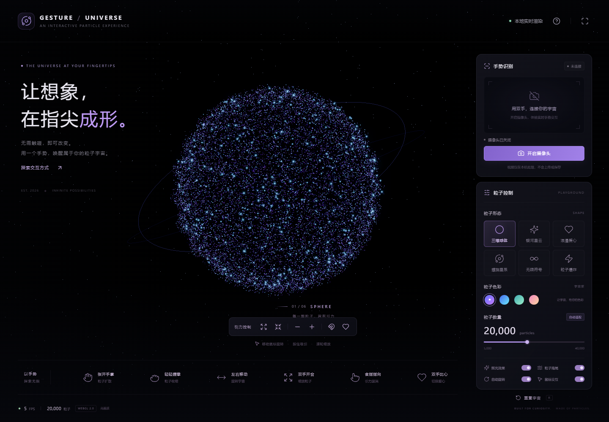
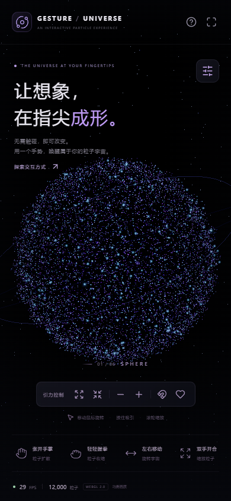
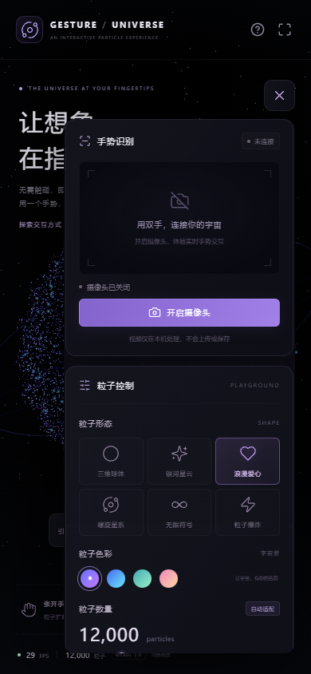

# 使用教程

[返回项目首页](../README.md) · [技术说明](TECHNICAL.md)

## 1. 第一次打开

打开[在线体验](https://lizijiaohu.s13753540656.workers.dev/)。页面先展示粒子球体，默认不会申请摄像头。

可以先移动鼠标旋转粒子，按住画面吸引粒子，再用滚轮缩放。没有摄像头也能体验六种形态和四组配色。

## 2. 开启摄像头

1. 点击右侧「开启摄像头」。手机端先点右上角的滑杆图标打开面板。
2. 在浏览器提示中选择允许摄像头。项目不需要麦克风权限。
3. 等待摄像头预览出现、状态变为「运行中」。首次初始化可能需要片刻。
4. 让手部完整出现在预览画面内，观察关键点连线和识别状态。
5. 使用结束后点击「关闭摄像头」。

摄像头必须在 HTTPS 网站或电脑本机 localhost 环境中使用。将项目直接作为 HTML 文件双击打开，或通过手机访问局域网 HTTP 地址，都不适合摄像头识别。

## 3. 六种手势

| 手势 | 怎么做 | 预期效果 | 屏幕替代操作 |
| --- | --- | --- | --- |
| 张开手掌 | 手掌朝向镜头，展开四指与拇指，稍作停留 | 粒子向外扩散 | 底部扩散按钮 |
| 握拳 | 将四指收拢，保持拳头完整可见 | 粒子向中心收缩 | 底部收缩按钮 |
| 左右移动 | 缓慢左右移动手掌，保持手部在画面内 | 粒子结构跟随转动 | 鼠标或触屏移动；自动旋转开关 |
| 双手开合 | 先让双手被检测到，再拉开或靠近 | 相对双手首次距离缩放 | 底部加号、减号 |
| 食指指向 | 只伸出食指，收起中指、无名指和小指 | 指尖对应位置产生局部漩涡 | 按住画面；底部中心漩涡按钮 |
| 双手比心 | 两手食指尖在上方靠近，拇指尖在下方靠近，形成心形 | 保持约半秒后切换爱心 | 右侧爱心形态；底部爱心按钮 |

动作需稳定片刻才会生效，这是为了过滤短暂误识别。比心较依赖视角与遮挡情况，可以直接使用爱心按钮。这里的比心指双手构成心形，不是单手拇指和食指交叉的小爱心。

双手缩放是相对控制：第一次同时识别到双手时记录基准距离。若希望重新建立基准，可以先移走一只手，再重新展示双手。

建议保持光线均匀，避免强背光和手指互相遮挡。具体拍摄距离取决于摄像头视角，以预览中双手完整可见为准。

## 4. 面板与按钮

- **形态**：球体、银河星云、爱心、螺旋星系、无限符号、粒子爆炸，切换时平滑过渡。
- **颜色**：宇宙紫、深海蓝、极光绿、落日粉。
- **粒子数量**：自动适配根据设备和帧率调节；拖动滑杆后进入手动模式。
- **辉光 / 拖尾**：影响画面效果和渲染开销，低性能设备可关闭。
- **自动旋转**：控制持续旋转；手掌和鼠标的交互旋转仍由输入驱动。
- **鼠标交互**：开启后会关闭摄像头，改用鼠标或触屏控制。
- **重置宇宙**：恢复形态、颜色、粒子数量、缩放等初始状态，不会关闭正在使用的摄像头。
- **顶部问号**：打开页内手势指南；顶部全屏图标可尝试进入全屏。

摄像头运行时，手动交互按钮有 2.5 秒优先窗口，之后恢复跟随手势。右侧面板、底部引力按钮及手势速查按钮都可点击。

## 5. 手机操作

<table>
<tr><td></td><td></td></tr>
<tr><td>画面与底部交互</td><td>右上角展开设置</td></tr>
</table>

1. 使用手机浏览器打开 HTTPS 在线网址。
2. 滑动画面旋转，按住画面产生吸引，点击底部加减按钮缩放。
3. 点击右上角滑杆图标展开面板；面板内部可上下滚动，底部手势速查栏可横向滑动。
4. 开启摄像头时，建议把手机放在稳定支架上，腾出双手。
5. 某些移动浏览器不支持全屏 API，仍可正常使用普通页面。

现代 Safari / Chrome 是移动适配目标，目前完整的真人手势表现仍需要在具体手机上验证。应用内嵌浏览器可能限制摄像头；遇到限制时请复制地址到手机系统浏览器再试。

## 6. 快捷键

| 按键 | 操作 |
| --- | --- |
| R | 重置宇宙 |
| H | 打开或关闭手势指南 |
| Esc | 关闭指南或手机设置面板；浏览器可同时退出全屏 |

在输入框或按钮上操作时，部分快捷键会被忽略。

## 7. 注意事项与隐私

- 应用不录制、保存或上传摄像头画面；网页和模型资源仍需要通过普通网络请求加载。
- 切换到后台会暂停粒子渲染和推理，但摄像头连接仍可能保持。如不再使用，请主动关闭摄像头。
- 摄像头关闭、页面离开或组件卸载时会清理视频流、识别器和 Worker。
- 手势是交互控制，不用于身份验证、医疗测量或通用手语翻译。
- 模型加载和图形表现受浏览器、显卡、设备温度和摄像头质量影响，没有对所有设备承诺统一帧率或识别准确率。

## 8. 常见问题

| 现象 | 建议处理 |
| --- | --- |
| 权限被拒绝 | 在浏览器地址栏站点设置中允许摄像头，再点击重新连接 |
| 未找到摄像头 | 检查设备是否连接、系统摄像头权限是否开启 |
| 摄像头被占用 | 关闭其他使用摄像头的程序，再重试 |
| 有预览但没有识别 | 增加光线、完整展示手部、减少遮挡，先尝试单手开掌 |
| 比心不稳定 | 两对指尖分别靠近并稍作停留，或点击爱心按钮 |
| 模型初始化失败 | 检查网络与部署资源；本地项目重新执行 npm install，保证模型文件存在 |
| 画面卡顿或手机发热 | 开启自动适配，降低数量，关闭辉光与拖尾 |
| WebGL 错误或上下文丢失 | 开启浏览器硬件加速，刷新页面，必要时重启浏览器 |
| 页面在某个网络打不开 | 用另一浏览器或网络对比排查，网络连接错误和摄像头识别错误需要分别处理 |

若需要反馈问题，请提供设备型号、系统和浏览器版本、操作步骤、错误提示与是否开启摄像头。无需提供原始摄像头视频。
